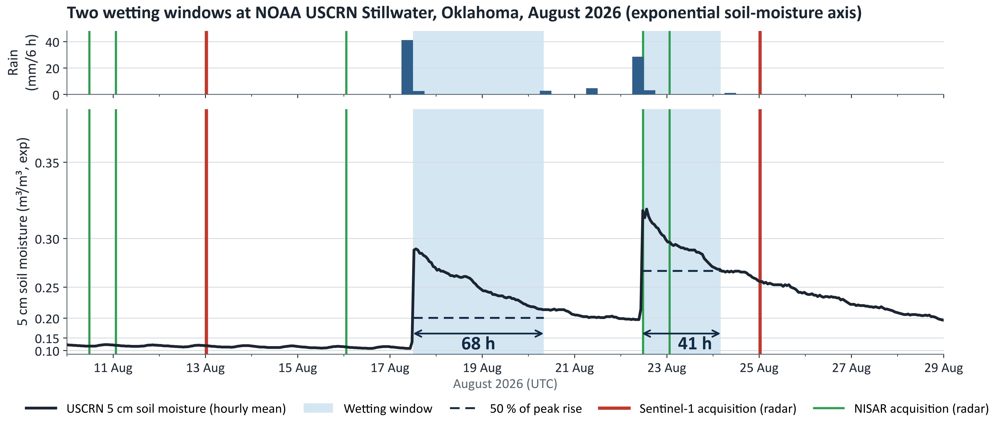
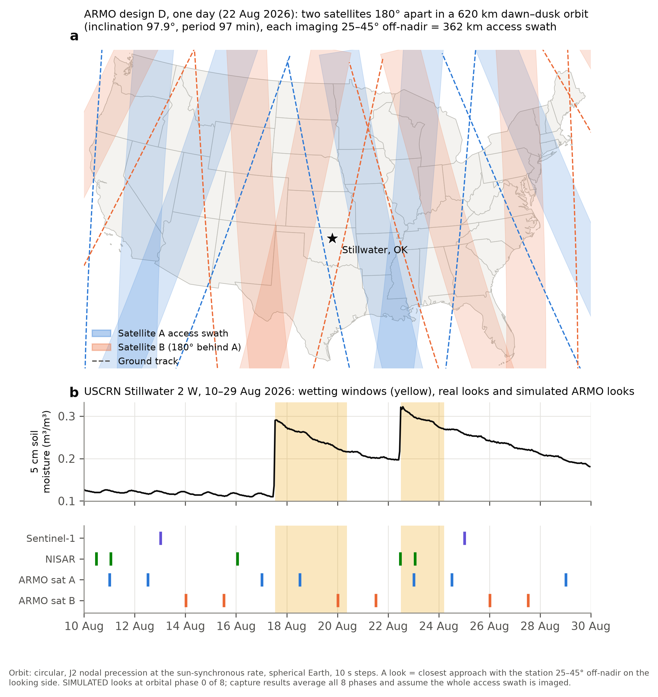
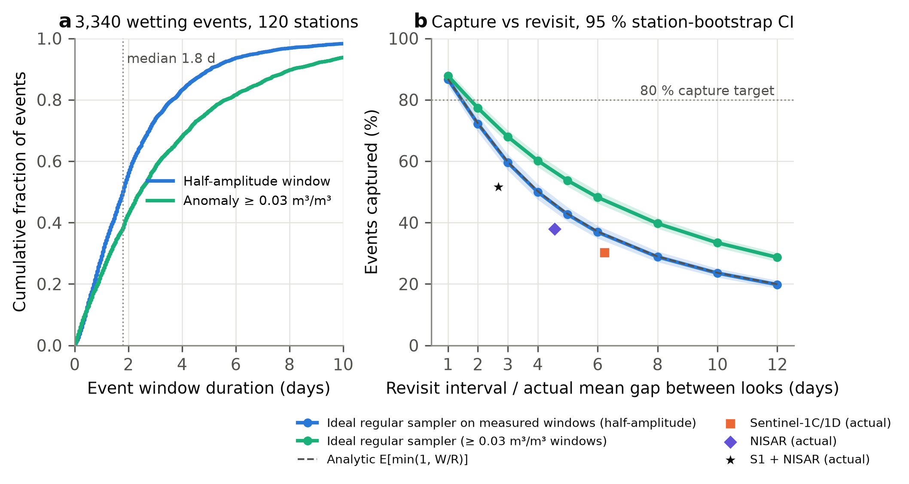
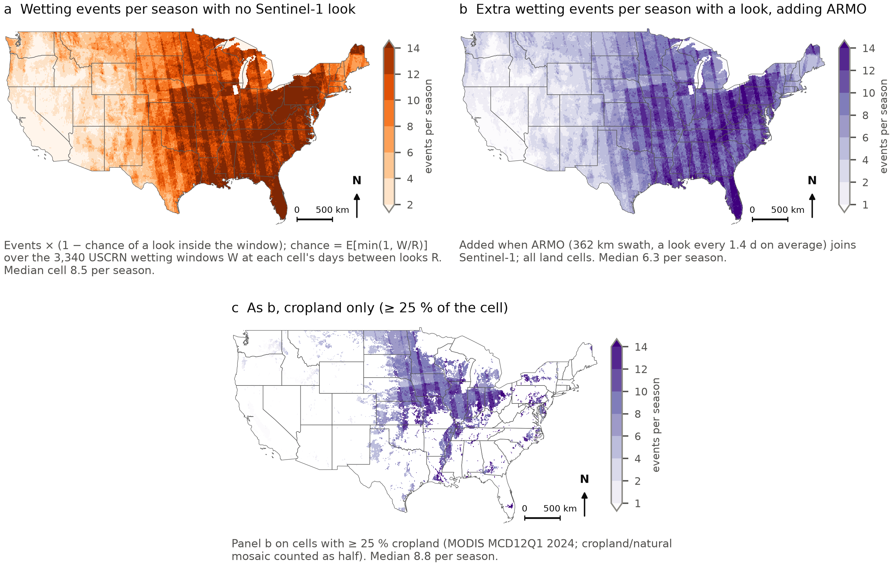

# ARMO: Agricultural Rapid Moisture Observatory

ES4304 (NTU) remote-sensing final project, Group 2. After rain, soil moisture near the surface rises within hours and
dries back within a day or two. We tested whether today's field-scale radar satellites look often enough to see these
**wetting events**, and designed a mission that would.

Against hourly ground truth from NOAA's U.S. Climate Reference Network (USCRN), the real Sentinel-1 + NISAR fleet had a
radar look inside only **51.6 %** of 979 wetting events in 2026. **ARMO**, two L-band radar satellites 180° apart in
one orbit, raises this to **81.5 %** in simulation.

**Terms.** A *look* is a satellite acquisition. An event is *captured* when at least one look falls inside its wetting
window. A *detection* is a captured look whose data show the wetting. This work measures capture.


*Two wetting events at USCRN Stillwater, Oklahoma, August 2026 (soil moisture on an exponential axis, which stretches
the wet peaks). No field-scale radar looked during the first 68-hour window; NISAR looked during the second.*

## Key results

| Result | Value | Evidence | Slide | Source |
|---|---|---|---|---|
| Wetting events, 120 stations, Apr–Oct 2025–2026 | 3,340 | observed | 4 | `code/01_events.py` |
| Median wetting window; share shorter than 48 h | 1.8 d; 55 % | observed | 8 | `code/01_events.py` |
| Events captured by Sentinel-1 / NISAR / both (979 events, 107 stations, 17 Jun–31 Oct 2026) | 30.2 / 37.9 / 51.6 % | observed | 10 | `code/02_real_schedules.py` |
| Regular revisit needed for 80 % capture | 1.46 d (1.31–1.64) | simulated | 17 | `code/01_events.py` |
| Fleet + ARMO (design D); ARMO alone | 81.5 % (+29.9 points); 76.1 % | simulated | 12 | `code/06_mission_design.py` |
| Five designs, fleet + ARMO (A–E) | 71.1 / 70.1 / 77.2 / **81.5** / 77.4 % | simulated | 13 | `code/06_mission_design.py` |
| Spacecraft (design D, per satellite) | ≈ 316 kg wet, ≈ 2.8 kW peak RF, 5.9 m reflector, 1.26 GHz | estimate | 11 | `code/06` `realistic_sizing()` |

`code/15_slide_numbers.py` recomputes all 76 analysis numbers in the presentation and checks them against the slides.
Slides 3, 18 and 19 also cite published and agency sources ([listed below](#literature)).

## The orbit simulator

`code/06_mission_design.py` flies each candidate ARMO design and turns it into look times at every USCRN station:

- **Orbit:** circular, 620 km, sun-synchronous (inclination 97.9° from the J2 condition), dawn–dusk (ascending node
  18:00 local), J2 nodal precession, Earth rotation; positions every 10 s from June to November 2026.
- **Looks:** a side-looking SAR sees a station at closest approach when the station is 25–45° off-nadir on its looking
  side, a 362 km access swath. Rolling designs look left and right on alternate orbits.
- **Designs:** one satellite (A), one rolling (B), one rolling with 20–50° access (C), two satellites 180° apart (D),
  two rolling (E).
- **Scoring:** simulated looks are merged with the real Sentinel-1 and NISAR look times and scored against the 979
  observed wetting windows, averaged over 8 starting orbital positions.


*(a) One day of design D: two satellites, each sweeping a 362 km swath on morning and evening passes.
(b) At Stillwater, ARMO looks twice inside the 17 August window that Sentinel-1 and NISAR missed.*

```bash
python code/06_mission_design.py               # designs A–E, head-to-head, sizing and cost (about 6 min)
python code/06_mission_design.py event_flags   # per-event looks by design and orbital phase (about 10 min)
python figures/fig_orbit_simulation.py         # the figure above
```

## Results


*Over half of wetting windows last less than 48 hours (a), so capturing 80 % of them needs a look about every
1.5 days (b). Today's satellites, plotted at their mean gap between looks, fall well short.*


*On the same 979 events, adding ARMO design D raises capture from 51.6 % to 81.5 % (paired gain +29.9 points, 95 % CI
27.2–32.6). Only design D, two satellites 180° apart, passes 80 %. Events shorter than a day remain hard to catch.*


*Wetting events per season that Sentinel-1 misses, and the events ARMO would add, across the contiguous US
(0.1° screening maps calibrated with USCRN).*

## Repository

```
code/      analysis scripts in run order (00–15) and common.py; per-script details in code/README.md
figures/   slideNN_*.png   figures on presentation slide NN
           figSNN_*.png    supplementary figures S01–S15
           fig_*.py        the scripts that draw them; figure_manifest.csv lists inputs, cohort and placement
tests/     11 deterministic checks
docs/      METHOD_NOTES.md (results and limitations per figure); EVO1_budget_illustrative.csv (slide 19)
```

Supplementary figures, in slide order: ground truth (S01–S05), why radar (S06), what the fleet misses (S07), capture
versus detection (S08–S10), orbit simulator and ARMO results (S11–S13), need maps (S14–S15).

No data are included: the scripts download everything into `data/` (about 1 GB).

## Reproducing

**Setup.** Python 3.14 (other recent 3.x should work):

```bash
git clone https://github.com/zheniannn/ARMO.git && cd ARMO
python -m venv .venv          # then activate it
pip install numpy==2.5.4 pandas==3.1.0 scipy==1.18.1 matplotlib==3.11.2 requests==2.34.2 \
    pystac-client==0.9.1 planetary-computer==1.0.0 rasterio==1.5.2 pyproj==3.8.0 geopandas==1.2.0 \
    pyogrio==0.13.0 shapely==2.2.0 h5py==3.16.0 fsspec==2026.9.0 aiohttp==3.14.5 earthengine-api==1.7.50
```

- **NASA Earthdata** (free; scripts 05, 13, 14): put `machine urs.earthdata.nasa.gov login <user> password <pass>` in
  `~/.netrc` (Windows: `%USERPROFILE%\_netrc`).
- **Google Earth Engine** (free for non-commercial use; scripts 07, 09–12 and `fig_case_studies.py`): run
  `earthengine authenticate` once and set `EE_PROJECT` to your Cloud project.
- Everything else (NOAA, Planetary Computer, NASA CMR, Open-Meteo, Natural Earth) is anonymous.

**Run** from the repository root:

```bash
for s in 00 01 02 03 04 05 06 07 08 09 10 11 12 13 14; do python code/${s}_*.py; done   # 04, 09, 11 optional
python code/06_mission_design.py event_flags
for f in figures/fig_*.py; do python "$f"; done
python code/15_slide_numbers.py && python figures/reproduce_anchors.py && python figures/build_manifest.py
python tests/test_evidence.py
```

Downloads are cached, so an interrupted script continues where it stopped. The analysis is deterministic (fixed seeds
and date windows ending 31 Oct / 1 Nov 2026; data downloaded 1 Nov 2026). Providers revise recent records, so a later
download can shift the last digits; `code/15` reports which slide values moved.

## Data

| Data | Provider |
|---|---|
| Hourly 5 cm soil moisture and rain (ground truth) | NOAA USCRN hourly02 |
| Sentinel-1 look times and RTC backscatter | ESA Copernicus, via Microsoft Planetary Computer |
| NISAR look times, L3 soil moisture (SME2, provisional), L2 GCOV backscatter | NASA / ISRO, via NASA CMR and ASF |
| SMAP, MODIS, ESA WorldCover, USDA CDL, gridMET, Sentinel-1 GRD | Google Earth Engine |
| ERA5-Land | ECMWF, via Open-Meteo |
| State outlines | Natural Earth 1:50m |

## Literature

- Slide 3: FAO (2023), *The Impact of Disasters on Agriculture and Food Security*; Reyes & Elias (2019), *Environ.
  Res. Lett.* 14, 074017; Zappa et al. (2024), *Agric. Water Manag.* 295, 108773; Ortenzi et al. (2025),
  *J. Hydrometeorol.* 26, 975–990.
- Slides 14–15: Abatzoglou (2013), *Int. J. Climatol.* 33, 121–131 (gridMET).
- Slide 18: ASF NISAR SME2 product guide; ESA ROSE-L Mission Advisory Group; Acuña et al. (2020); Jones et al. (2026),
  *Earth Space Sci.*; Spire D-HSSM documentation (accessed 3 Nov 2026).
- Slide 19: NASA ESSP EVO-1 Community Announcement (24 Mar 2026) and Q&A Rev. 01 (31 Jul 2026),
  https://essp.larc.nasa.gov/EVO-1. The US$ 115 M request is preliminary; the bottom-up estimate from `code/06` is
  ≈ US$ 149.8 M, so the design needs cost reconciliation to fit it.

## Limitations

- **ARMO's results are simulated** and assume the whole 362 km access swath is imaged; a usable 220–300 km gives
  72–79 % (`figS13`).
- **Capture is not detection.** Today's field-scale radars detect 23–37 % of the events they capture (`figS08`–`figS10`).
- The 51.6 % baseline counts every pass whose footprint contains a station; pixel checks at the case-study sites found
  6 of 18 NISAR passes invalid (`code/14`).
- Only 9 of 121 stations are cropland (`figS02`). NISAR products are provisional and cover one season.
- No commercial daily product could be tested. Sizing and cost are concept-stage estimates.

More detail: [docs/METHOD_NOTES.md](docs/METHOD_NOTES.md).

## Licence

Code: MIT (see `LICENSE`). Data belong to their providers.
