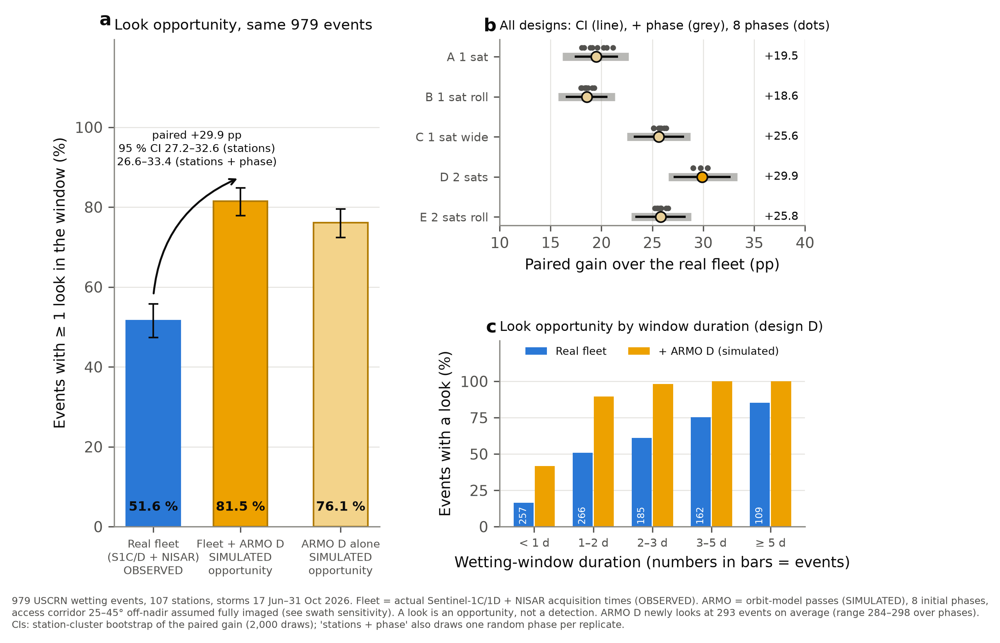

# ARMO: Agricultural Rapid Moisture Observatory

ES4304 (NTU) remote-sensing final project, Group 2. This repository holds the analysis behind our presentation, which
asks one question: **are today's field-scale radar satellites missing the rain?**

After rain, near-surface soil moisture rises within hours and dries back within a day or two. Using hourly ground
truth from 120 NOAA U.S. Climate Reference Network (USCRN) stations, we found that the real Sentinel-1 and NISAR
fleet had a radar look inside only **51.6 %** of 979 wetting events in 2026. We then designed **ARMO**, two L-band
radar satellites 180° apart in one orbit. In simulation, adding ARMO raises that share to **81.5 %**.

Every analysis number in the presentation is recomputed from the data and checked against the slide by
`code/15_slide_numbers.py` (76 values, all matching).

## Terms

| Term | Meaning |
|---|---|
| **Look** | A satellite acquisition over a station |
| **Capture** | At least one look falls inside an event's wetting window: an observation opportunity |
| **Detection** | A captured look whose data show the wetting under the stated rule: a positive result |

A capture is not a detection. The presentation and this repository measure capture.


*Slide 5: two real wetting events at USCRN Stillwater 2 W, Oklahoma, in August 2026. No field-scale radar looked
during the first 68-hour window; NISAR looked twice during the second.*

## The presentation, slide by slide

Evidence classes follow the slides: **observed** (ground truth or real acquisitions), **simulated** (orbit model or
idealised sampler), **literature** (published or agency sources, not computed here).

| Slide | Claim | Evidence | Where it comes from |
|---|---|---|---|
| 3 | Soil moisture matters for irrigation and flood readiness; US$ 123 B crop losses from disasters; ~71 % of insured US crop losses linked to drought and excess rain | literature | [Sources](#sources-for-the-literature-claims) |
| 4 | 3,340 wetting events at 120 stations, April–October 2025–2026; event rules: ≥ 5 mm storm, ≥ 0.03 m³/m³ rise at 5 cm, window = time above half the peak rise | observed | `code/01_events.py`, `code/common.py`; map `figures/slide04_study_area.png` |
| 5 | Two Stillwater windows (68 h, 41 h): the first missed, the second captured; 11 NISAR-era events at the station, 5 with any radar look | observed | `figures/fig_wetting_window.py` → `slide05_wetting_windows.png` |
| 6 | Sentinel-1 backscatter change tracks rain (r = 0.74; +0.9 dB vs −0.4 dB), but its looks fall outside both windows | observed | `code/12`, `code/14`, `figures/fig_case_studies.py` → `slide06_stillwater_sentinel1.png` |
| 7 | NISAR L-band change tracks rain (r = 0.57; +2.2 dB vs +0.5 dB) and its looks fall inside the second window | observed | `code/13`, `figures/fig_case_studies.py` → `slide07_stillwater_nisar.png` |
| 8 | Median wetting window 1.8 days; 55 % shorter than 48 h | observed | `code/01_events.py` (histogram recomputed in `code/15`) |
| 9 | Resolution ladder: SMAP 9 km, NISAR 200 m, Sentinel-1 10 m over the same scene | observed | `code/12`, `figures/fig_slide_assets.py`, `figures/fig_resolution_ladder_legend.py` |
| 10 | Capture by Sentinel-1 30.2 %, NISAR 37.9 %, both 51.6 % (979 events, 107 stations, 17 Jun–31 Oct 2026) | observed | `code/02_real_schedules.py`, `code/06_mission_design.py` |
| 11 | ARMO: 2 satellites, 620 km dawn–dusk orbit, 1.26 GHz HH + HV, 5.9 m reflector, ≈ 316 kg, 362 km access swath | simulated | `code/06_mission_design.py` (`realistic_sizing()` for mass and power) |
| 12 | Fleet + ARMO 81.5 % (+29.9 points); ARMO alone 76.1 % | simulated | `code/06_mission_design.py`; paired CI in `figures/figS11_capture_gain_paired_ci.png` |
| 13 | Five designs: 71.1 / 70.1 / 77.2 / 81.5 / 77.4 %; only design D (two satellites, 180° apart) passes 80 % | simulated | `code/06_mission_design.py` |
| 14–15 | Maps of Sentinel-1 look gaps, missed events, and where ARMO adds looks | observed + simulated | `code/10_gee_need_maps.py`, `figures/fig_need_maps_split.py` |
| 16 | From looks to irrigation and flood decisions | concept | – |
| 17 | 80 % capture needs a regular revisit of ~1.5 days (1.46 d, 95 % band 1.31–1.64) | simulated | `code/01_events.py` (`capture_synthetic.csv`); `figures/figS05_capture_vs_revisit.png` |
| 18 | Fleet median gap 2.0 d; fleet + ROSE-L 63.7 %; SMAP retrieval in 77 % of windows (27 % recommended quality) | observed / simulated | `code/06`, `code/08_sensor_tests.py` |
| 18 | ROSE-L, SAOCOM and commercial-product facts | literature | [Sources](#sources-for-the-literature-claims) |
| 19 | US$ 115 M NASA EVO-1 request; illustrative allocation | literature | `docs/EVO1_budget_illustrative.csv`; bottom-up estimate US$ 149.8 M from `code/06` (`armo_cost.csv`) |
| 20 | 51.6 % → 81.5 % | as slides 10 and 12 | – |


*Same 979 events: (a) the real fleet captures 51.6 %, adding simulated ARMO design D gives 81.5 % (paired gain +29.9
points, 95 % CI 27.2–32.6); (b) paired gain for all five designs; (c) capture by wetting-window duration.*

**Funding.** The presentation proposes ARMO for NASA's Earth Venture Orbital-1 (EVO-1), Category (c) full mission, at
US$ 115 M: the upper end of the US$ 35–115 M range in NASA's March 2026 Community Announcement (FY2026 dollars).
NASA's July 2026 Q&A lists US$ 115 M for a full mission, launch included, in FY2028 dollars. The request is
preliminary and subject to the final solicitation. The project's bottom-up cost model gives ≈ US$ 149.8 M, so the
design needs scope and cost reconciliation to fit the cap (as stated on slide 19).

## What is in this repository

```
code/      data downloads and analysis, numbered in run order (00-15), plus common.py
figures/   slideNN_*.png   figures used on presentation slide NN
           figSNN_*.png    supplementary figures S01-S14, in the order of the slides they support
           fig_*.py        the scripts that draw them (figstyle.py = shared style)
           figure_manifest.csv lists every figure, its inputs, cohort, uncertainty and placement
           generated/      the statistics behind each figure and the check results
tests/     deterministic checks (python tests/test_evidence.py)
docs/      method notes and limitations (METHOD_NOTES.md); slide 19 allocation (EVO1_budget_illustrative.csv)
LICENSE    MIT
```

**Slide figures**

| File | Slide |
|---|---|
| `slide01_title_background.png` | 1, 2 and 20 |
| `slide04_study_area.png` | 4 |
| `slide05_wetting_windows.png` | 5 |
| `slide06_stillwater_sentinel1.png` | 6 |
| `slide07_stillwater_nisar.png` | 7 |
| `slide09_resolution_ladder.png`, `slide09_resolution_ladder_legend.png` | 9 |
| `slide14_need_maps_looks_events.png` | 14 |
| `slide15_need_maps_armo_gain.png` | 15 |

The charts on slides 8, 10, 12, 13 and 17 were drawn in PowerPoint; their numbers are recomputed by `code/15`.

**Supplementary figures**

| File | What it shows | Supports |
|---|---|---|
| `figS01_study_area.png` | Station map, report layout | slide 4 |
| `figS02_vegetation_representativeness.png` | Land cover and vegetation at the stations (9 cropland) | slide 4 |
| `figS03_sampling_robustness.png` | Results under alternative event definitions | slides 4, 8 |
| `figS04_depth_comparison.png` | 5 cm vs 10 cm probe windows | slide 4 |
| `figS05_capture_vs_revisit.png` | Window durations; capture against revisit interval | slides 8, 17 |
| `figS06_optical_cloud_penalty.png` | Why not optical: clear-sky opportunities lost to cloud | slide 9 |
| `figS07_event_capture_severity.png` | Which real events the fleet misses | slide 10 |
| `figS08_quality_attrition.png` | From a look to a detected change, per sensor | capture ≠ detection |
| `figS09_detection_operating_curve.png` | Detection against false alarms, held-out thresholds | capture ≠ detection |
| `figS10_detection_matrix.png` | Detection confusion matrices | capture ≠ detection |
| `figS11_capture_gain_paired_ci.png` | Paired capture gain for all five ARMO designs | slides 12, 13 |
| `figS12_swath_capture_sensitivity.png` | ARMO's benefit if less than the 362 km access swath is imaged | slide 12 |
| `figS13_need_maps_report.png` | Four-panel need maps (report version) | slides 14, 15 |
| `figS14_map_spatial_validation.png` | Held-out check of the need maps against the stations | slides 14, 15 |

**No data is included.** The scripts download everything and write it under `data/` (about 1 GB). The slide deck
itself is not included.

## Setup

1. **Python 3.14** (other recent 3.x versions should work). Create an environment and install the tested versions:
   ```bash
   git clone https://github.com/zheniannn/ARMO.git
   cd ARMO
   python -m venv .venv
   # Windows: .venv\Scripts\activate      macOS/Linux: source .venv/bin/activate
   pip install numpy==2.5.4 pandas==3.1.0 scipy==1.18.1 matplotlib==3.11.2 requests==2.34.2 \
       pystac-client==0.9.1 planetary-computer==1.0.0 rasterio==1.5.2 pyproj==3.8.0 geopandas==1.2.0 \
       pyogrio==0.13.0 shapely==2.2.0 h5py==3.16.0 fsspec==2026.9.0 aiohttp==3.14.5 earthengine-api==1.7.50
   ```
2. **NASA Earthdata login** (free; needed for the NISAR downloads, scripts 05, 13 and 14). Register at
   https://urs.earthdata.nasa.gov and put your credentials in `~/.netrc` (on Windows, `%USERPROFILE%\_netrc`):
   ```
   machine urs.earthdata.nasa.gov login <your user name> password <your password>
   ```
3. **Google Earth Engine** (free for non-commercial use; needed by scripts 07, 09, 10, 11 and 12, and by
   `figures/fig_case_studies.py` on its first run). Register a Cloud project for
   Earth Engine, then authenticate once and tell the scripts your project:
   ```bash
   earthengine authenticate
   export EE_PROJECT=<your-cloud-project-id>        # PowerShell: $env:EE_PROJECT = "<your-cloud-project-id>"
   ```

Everything else (NOAA, Microsoft Planetary Computer, NASA CMR, Open-Meteo, Natural Earth) is anonymous. Never commit
credentials: `.gitignore` already excludes `.netrc` and `_netrc`.

## Recreating the work

Run everything from the repository root. Each script reads only what earlier scripts wrote. Scripts that download data
save what they fetch; if one stops part-way (for example when a server refuses requests), run it again and it
continues from what it already has.

```bash
# 1. Analysis (downloads, then offline analysis)
python code/00_download_raw.py
python code/01_events.py
python code/02_real_schedules.py
python code/03_extract_s1_backscatter.py
python code/04_era5land_baseline.py              # optional: model baseline
python code/05_extract_nisar_sme2.py
python code/06_mission_design.py
python code/06_mission_design.py event_flags     # per-event ARMO looks by design and orbital phase (about 10 min)
python code/07_gee_extract.py
python code/08_sensor_tests.py
python code/09_optical_clouds.py                 # optional: optical comparison
python code/10_gee_need_maps.py                  # also draws figS13
python code/11_cross_checks.py                   # optional: checks the inputs against second providers
python code/12_extract_imagery.py                # imagery for slides 1, 6 and 9
python code/13_extract_nisar_gcov.py             # NISAR before/after subsets for slide 7
python code/14_check_station_validity.py         # is each case-study look a usable pixel at the station?

# 2. Slide figures
python figures/fig_slide_assets.py               # slides 1 and 9
python figures/fig_resolution_ladder_legend.py   # slide 9
python figures/fig_study_area.py                 # slide 4 (and figS01)
python figures/fig_wetting_window.py             # slide 5
python figures/fig_case_studies.py               # slides 6 and 7 (--all: every site and style)
python figures/fig_need_maps_split.py            # slides 14 and 15

# 3. Supplementary figures (offline)
python figures/fig_vegetation_representativeness.py
python figures/fig_sampling_robustness.py
python figures/fig_depth_comparison.py
python figures/fig_capture_vs_revisit.py
python figures/fig_optical_cloud_penalty.py
python figures/fig_event_capture_severity.py
python figures/fig_quality_attrition.py
python figures/fig_detection_operating_curve.py
python figures/fig_detection_matrix.py
python figures/fig_capture_gain_paired_ci.py
python figures/fig_swath_capture_sensitivity.py
python figures/fig_map_spatial_validation.py

# 4. Checks
python code/15_slide_numbers.py                  # every analysis number in the slides -> figures/generated/slide_numbers.csv
python figures/reproduce_anchors.py              # 36 headline numbers -> figures/generated/anchor_check.csv
python figures/build_manifest.py                 # figures/figure_manifest.csv
python tests/test_evidence.py                    # 11 checks -> figures/generated/test_results.csv
```

| Script | What it does | Downloads from | Writes (under data/processed unless stated) |
|---|---|---|---|
| `00_download_raw.py` | USCRN hourly files for 2025 and 2026 (lower 48 states) and Natural Earth outlines, about 550 MB | NOAA, Natural Earth | `data/raw/` |
| `01_events.py` | Quality-controls the ground truth, finds wetting events, tests capture by regular revisits, bootstrap CIs | – | `uscrn_hourly.pkl`, `station_seasons.csv`, `events.csv`, `capture_synthetic.csv`, `sensitivity.csv` |
| `02_real_schedules.py` | Real Sentinel-1 and NISAR pass times at every station; real capture | Planetary Computer, NASA CMR | `acq_*.csv`, `capture_real.csv`, `revisit_real.csv` |
| `03_extract_s1_backscatter.py` | Sentinel-1 backscatter windows at each station (cloud-optimised range reads; one of the longest steps) | Planetary Computer | `s1_cache/`, `s1_backscatter.csv` |
| `04_era5land_baseline.py` | ERA5-Land reanalysis as a no-new-satellite baseline | Open-Meteo (rate-limited) | `data/raw/era5land/`, `era5_*.csv` |
| `05_extract_nisar_sme2.py` | NISAR soil moisture and L-band backscatter at each station (HDF5 range reads from 2,673 files; one of the longest steps) | NASA ASF (Earthdata login) | `nisar_cache/`, `nisar_sme2_points.csv` |
| `06_mission_design.py` | Orbit simulation of ARMO designs A–E; head-to-head against the fleet and ROSE-L; 10 cm depth test; spacecraft sizing, mass and cost (about 6 min; `event_flags` adds per-event and swath results) | – | `armo_*.csv`, `performance_headtohead.csv`, `depth_*.csv` |
| `07_gee_extract.py` | SMAP, MODIS NDVI, ESA WorldCover and USDA CDL at each station | Earth Engine | `gee_*.csv` |
| `08_sensor_tests.py` | Sentinel-1, NISAR and SMAP against ground truth; detection by vegetation and land cover | – | `s1_*.csv`, `nisar_*.csv`, `smap_*.csv`, `detection_strata.csv`, `station_vegetation.csv` |
| `09_optical_clouds.py` | MODIS cloud mask at each overpass: could an optical sensor see the events? | Earth Engine | `optical_*.csv` |
| `10_gee_need_maps.py` | CONUS need maps, checked against the stations | Earth Engine | `need_*`, `figures/figS13_need_maps_report.png` |
| `11_cross_checks.py` | Optional checks of the inputs against second providers: Copernicus Data Space, ASF, Earth Engine ERA5-Land, gridMET | several | `cross_check*.csv` |
| `12_extract_imagery.py` | Sentinel-1 before and after storms at Stillwater OK, Oakley KS and Champaign IL (2026), gridMET rain, SMAP 9 km and NISAR 200 m soil moisture | Planetary Computer, Earth Engine, NASA ASF | `imagery/` |
| `13_extract_nisar_gcov.py` | NISAR L2 GCOV (L-band backscatter) before/after subsets, 60 × 60 km at 40 m, same track and frame | NASA ASF (Earthdata login) | `imagery/nisar_gcov/` |
| `14_check_station_validity.py` | Reads the pixel at the station for every case-study look: is it a usable observation? | Planetary Computer, NASA ASF | `acquisition_validity.csv` |
| `15_slide_numbers.py` | Recomputes the 76 analysis numbers in the presentation and compares them with the slides (exits 1 on any mismatch) | – | `figures/generated/slide_numbers.csv` |

**NISAR downloads (script 05).** The NISAR server (ASF) rate-limits bursts of requests from one address. The script
therefore uses 3 parallel workers in small batches and stops as soon as ASF refuses a whole batch. Files already
fetched are kept, so you can wait and run it again. To change the number of workers, set the `NISAR_WORKERS`
environment variable.

### Will I get the same numbers?

The analysis is deterministic. The bootstraps use fixed random seeds, and every download uses a fixed date window
ending on 31 October or 1 November 2026. Our data were downloaded on 1 November 2026.

Data providers keep publishing late records and revising recent ones, so a later download can differ slightly:
- USCRN adds November data to its yearly files, which can close the windows of storms on 31 October.
- Sentinel-1 and SMAP publish late scenes and retrievals.
- ERA5-Land's latency means it gains more days.
- gridMET replaces provisional days with final values.

Expect small differences in the last digits, not in the conclusions. `code/15_slide_numbers.py` will then report which
slide values moved.

## Data sources

| Data | Provider | Access |
|---|---|---|
| Hourly soil moisture, rain and temperature (ground truth) | NOAA U.S. Climate Reference Network, hourly02 | https://www.ncei.noaa.gov/pub/data/uscrn/products/hourly02/ |
| Sentinel-1 acquisition times and RTC backscatter | ESA Copernicus, via Microsoft Planetary Computer | STAC `sentinel-1-grd`, `sentinel-1-rtc` |
| NISAR acquisition times, L3 soil moisture (SME2), L2 GCOV backscatter | NASA / ISRO, via NASA CMR and ASF | `NISAR_L2_GCOV_*_V1`, `NISAR_L3_SME2_PROVISIONAL_V1` |
| SMAP L3E soil moisture, MODIS NDVI and cloud state, ESA WorldCover, USDA CDL, MODIS land cover, gridMET rain, Sentinel-1 GRD | Google Earth Engine catalogue | see scripts 07, 09, 10, 12 |
| ERA5-Land soil moisture, ERA5 rain | ECMWF, via Open-Meteo archive API | `models=era5_land`, `models=era5` |
| State and lake outlines | Natural Earth 1:50m | https://www.naturalearthdata.com |

The NISAR soil-moisture and GCOV products are **provisional** (version V1, June–October 2026), so their values may
change with reprocessing.

## Sources for the literature claims

These slide statements come from published or agency sources, not from the code:

- **Slide 3:** FAO (2023), *The Impact of Disasters on Agriculture and Food Security*; Reyes & Elias (2019),
  *Environmental Research Letters* 14, 074017; Zappa et al. (2024), *Agricultural Water Management* 295, 108773;
  Ortenzi et al. (2025), *Journal of Hydrometeorology* 26, 975–990.
- **Slides 14–15:** gridMET rainfall, Abatzoglou (2013), *International Journal of Climatology* 33, 121–131.
- **Slide 18:** ASF NISAR SME2 product guide; ESA ROSE-L Mission Advisory Group; Acuña et al. (2020);
  Jones et al. (2026), *Earth and Space Science*; Spire D-HSSM documentation (accessed 3 Nov 2026).
- **Slide 19:** NASA ESSP EVO-1 Community Announcement (24 Mar 2026) and Q&A Rev. 01 (31 Jul 2026),
  https://essp.larc.nasa.gov/EVO-1

## Limitations

- **ARMO's results are simulated.** 81.5 % assumes the whole 362 km access swath is imaged. The realistic sizing
  estimates about 220–300 km usable for soil moisture (30–45° incidence), for which the model gives 72–79 %
  (`figures/figS12_swath_capture_sensitivity.png`).
- **Capture is not detection.** Today's field-scale radars detect 23–37 % of the events they capture
  (`code/08_sensor_tests.py`, `figures/figS08`–`figS10`). Improving detection is outside this work.
- **The 51.6 % baseline may be slightly high.** It counts every pass whose footprint metadata contains a station.
  Reading the pixels for the three case-study sites found 6 of 18 NISAR passes invalid at the station
  (`code/14_check_station_validity.py`).
- **Cropland is under-represented:** 9 of the 121 classified stations are cropland (`figures/figS02`).
- **No commercial daily product** (e.g. Spire D-HSSM) could be tested: no independent accuracy or event-timing data
  exist.
- **The spacecraft sizing and cost are concept-stage estimates,** not quotes. The US$ 115 M request and the bottom-up
  US$ 149.8 M estimate are not yet reconciled.

## Licence and acknowledgements

The code is released under the MIT licence (see `LICENSE`). The data belong to their providers and are used under their
terms. The analysis code, documents and figures were produced with the help of an AI assistant (Claude, Anthropic)
under the team's direction.
