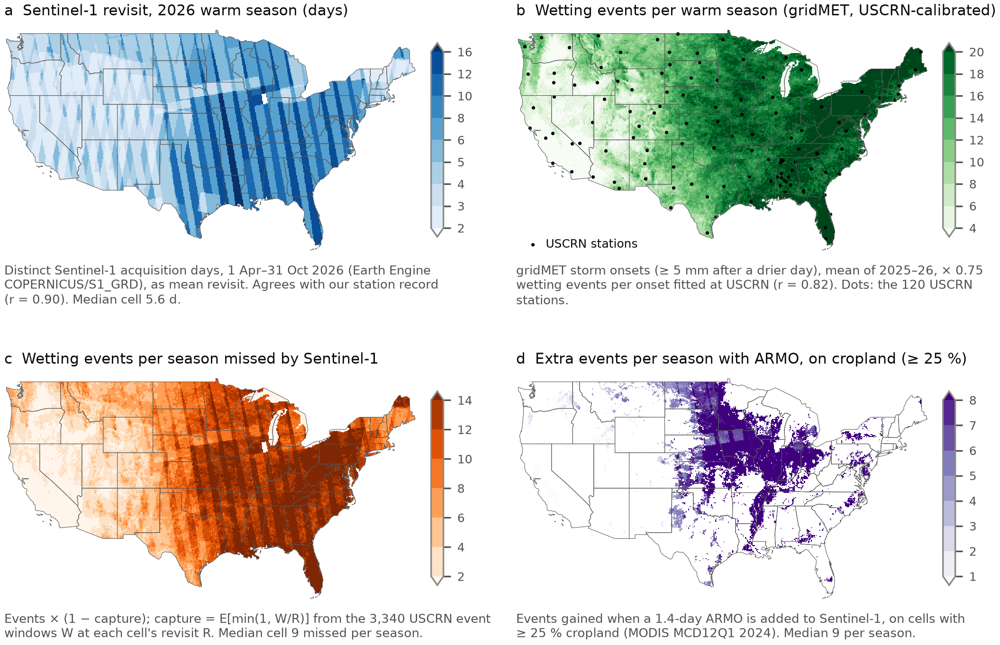
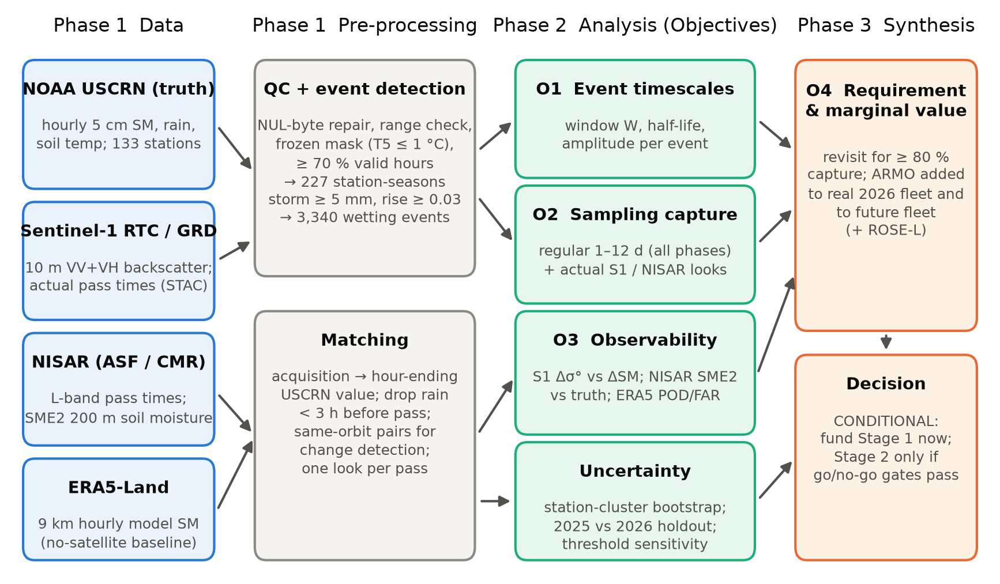
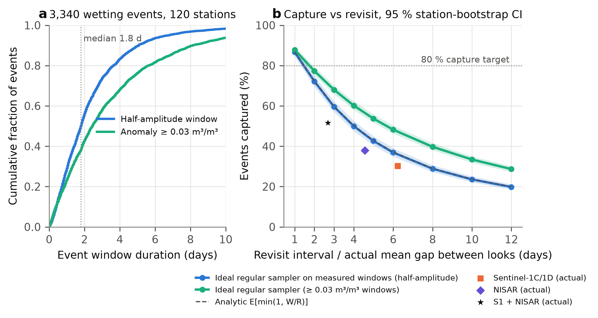
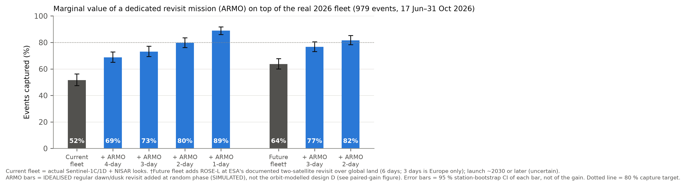

# ARMO: do field-scale radars blink through the rain?

ES4304 (NTU) remote-sensing final project. It is the proof of concept behind a NASA ROSES-style proposal for **ARMO**, the
Agricultural Rapid Moisture Observatory: two small L-band radar satellites giving a revisit of about 1.4 days over the
United States.

**The question:** after rain, soil moisture rises within hours and dries back over one to three days. Do today's
field-scale radars (Sentinel-1 and NISAR) look often enough to see these wetting events? If not, what would a mission
designed for them have to be?

**The approach:** we use hourly ground truth from 120 NOAA U.S. Climate Reference Network (USCRN) stations, 2025–2026. We
test the satellites' real acquisition times and their measurements against every wetting event the stations recorded.

## Main results

| Result | Value |
|---|---|
| Wetting events detected in the ground truth (120 stations, Apr–Oct 2025–2026) | 3,340 |
| Median duration of an event window | 1.8 days |
| Events seen by at least one look from the real Sentinel-1 + NISAR fleet (Jun–Oct 2026, 979 events) | 51.6 % |
| ... by NISAR alone / Sentinel-1 alone | 37.9 % / 30.2 % |
| ... by ARMO alone (design D: 2 satellites, 620 km dawn–dusk orbit, 1.42-day mean revisit) | 76.1 % |
| ... by the current fleet + ARMO | 81.5 % |
| Change noise ARMO needs to detect 70 % of sampled events | 0.038 m³/m³ (NISAR HH today: 1.45 dB; needed: 0.38 dB) |

So the fleet misses about half of all wetting events because it does not look often enough. Even when it does look, a
single look often cannot separate the wetting signal from noise. The proposal therefore has two stages. Stage 1 is a
2-year retrieval study (US$ 217,882). Stage 2 is the ARMO mission (≈ US$ 150 M, inside the NASA Earth Venture cap).
The revisit gain pays off even if retrieval does not improve.

### Where the need is

*Mapped in Google Earth Engine at 0.1° and calibrated with USCRN ground truth: Sentinel-1 revisit in the 2026 warm
season, wetting events per season, events Sentinel-1 misses, and the events ARMO would add over cropland.*

### Workflow


### Event windows against revisit

*(a) Distribution of event-window durations. (b) Event capture against revisit interval for regular sampling (bands =
95 % station-bootstrap CI; dashed = analytical model) and for the real fleets, plotted at their median gap between looks.*

### What ARMO adds

*Event capture by the real 2026 fleet, with ARMO added at a 1–4-day revisit, and by a future fleet that includes
ROSE-L at its documented 6-day global-land revisit. Error bars = 95 % station-bootstrap CI.*

## What is in this repository

```
code/      data downloads and analysis, numbered in run order (00-11), plus common.py
figures/   the figures, and the scripts that draw them (figstyle.py = shared style)
LICENSE    MIT
```

**No data is included.** You download everything yourself by running the scripts (see below). The scripts write all data
under `data/`, which they create, and need about 1 GB of disk space. The repository also leaves out the proposal,
slides and market review, and the scripts that build them.

## Setup

1. **Python 3.14** (other recent 3.x versions should work). Create an environment and install the tested versions:
   ```bash
   git clone https://github.com/zheniannn/ARMO.git
   cd ARMO
   python -m venv .venv
   # Windows: .venv\Scripts\activate      macOS/Linux: source .venv/bin/activate
   pip install numpy==2.5.4 pandas==3.1.0 scipy==1.18.1 matplotlib==3.11.2 requests==2.34.2 \
       pystac-client==0.9.1 planetary-computer==1.0.0 rasterio==1.5.2 pyproj==3.8.0 geopandas==1.2.0 \
       pyogrio==0.13.0 shapely==2.2.0 h5py==3.16.0 fsspec==2026.9.0 aiohttp==3.14.5 earthengine-api==1.7.50
   ```
2. **NASA Earthdata login** (free; only needed for the NISAR download, script 05). Register at
   https://urs.earthdata.nasa.gov and put your credentials in `~/.netrc` (on Windows, `%USERPROFILE%\_netrc`):
   ```
   machine urs.earthdata.nasa.gov login <your user name> password <your password>
   ```
3. **Google Earth Engine** (free for non-commercial use; needed by scripts 07, 09, 10 and 11). Register a Cloud project
   for Earth Engine, then authenticate once and tell the scripts your project:
   ```bash
   earthengine authenticate
   export EE_PROJECT=<your-cloud-project-id>        # PowerShell: $env:EE_PROJECT = "<your-cloud-project-id>"
   ```

Everything else (NOAA, Microsoft Planetary Computer, NASA CMR, Open-Meteo, Natural Earth) is anonymous. Never commit
credentials: `.gitignore` already excludes `.netrc` and `_netrc`.

## Recreating the work

Run every script from the repository root, in numerical order, then the figure scripts:

```bash
python code/00_download_raw.py
python code/01_events.py
python code/02_real_schedules.py
python code/03_extract_s1_backscatter.py
python code/04_era5land_baseline.py
python code/05_extract_nisar_sme2.py
python code/06_mission_design.py
python code/07_gee_extract.py
python code/08_sensor_tests.py
python code/09_optical_clouds.py
python code/10_gee_need_maps.py
python code/11_cross_checks.py        # optional: checks the inputs against second providers
python code/12_extract_imagery.py     # imagery for the slide figures
python figures/fig_study_area.py
python figures/fig2_workflow.py
python figures/fig3_4_6_results.py
python figures/fig5_observability.py
python figures/fig_sar_wetting_event.py
python figures/fig_resolution_ladder.py
python figures/fig_armo_coverage.py      # simulates ARMO's revisit on a 0.5° grid (about 15 min the first time)
python figures/fig_detection_matrix.py
```

**Evidence figures and checks (offline, from `data/processed` only; added 3 Nov 2026).** These recompute the headline
numbers, add paired and held-out uncertainty, and test the engineering assumptions. Run from the repository root:

```bash
python code/06_mission_design.py event_flags     # per-event ARMO look flags by design and orbital phase + usable-swath scenarios (about 10 min)
cd figures
python reproduce_anchors.py                      # recomputes the anchor numbers -> generated/anchor_check.csv
python fig_event_capture_severity.py             # which real events are missed
python fig_quality_attrition.py                  # look -> valid pair -> detected change, same 979 events
python fig_capture_gain_paired_ci.py             # paired gain from simulated ARMO, station and orbital-phase uncertainty
python fig_swath_capture_sensitivity.py          # what if ARMO images less than its 362 km access swath
python fig_detection_operating_curve.py          # detection vs false alarms, held-out operating points
python fig_map_spatial_validation.py             # held-out check of the need maps
python fig_vegetation_representativeness.py
python fig_sampling_robustness.py
python fig_depth_comparison.py
python fig_optical_cloud_penalty.py
python fig5_observability.py                     # uses generated/quality_attrition_stats.csv
python fig_mission_decision_frontier.py
python build_manifest.py                         # figures/figure_manifest.csv
cd ..
python tests/test_evidence.py                    # deterministic checks -> figures/generated/test_results.csv
```

Statistics behind every figure are written to `figures/generated/*.csv`; earlier versions of the revised figures are
kept in `figures/previous_2026-11-03/`. Method notes and limitations: `docs/FIGURE_SCIENTIFIC_AUDIT.md`.

Each script reads only what earlier scripts wrote. Scripts that download data save what they fetch. If a script stops
part-way, for example when a server refuses requests, run it again and it continues from what it already has.

| Script | What it does | Downloads from | Writes (under data/processed unless stated) |
|---|---|---|---|
| `00_download_raw.py` | USCRN hourly files for 2025 and 2026 (lower 48 states) and Natural Earth outlines, about 550 MB | NOAA, Natural Earth | `data/raw/` |
| `01_events.py` | Quality-controls the ground truth, finds wetting events, tests capture by regular revisits, bootstrap CIs | – | `uscrn_hourly.pkl`, `station_seasons.csv`, `events.csv`, `capture_synthetic.csv`, `sensitivity.csv` |
| `02_real_schedules.py` | Real Sentinel-1 and NISAR pass times at every station; real capture; ARMO's marginal value | Planetary Computer, NASA CMR | `acq_*.csv`, `capture_real.csv`, `revisit_real.csv`, `marginal_value.csv` |
| `03_extract_s1_backscatter.py` | Sentinel-1 backscatter windows at each station (cloud-optimised range reads; one of the longest steps) | Planetary Computer | `s1_cache/`, `s1_backscatter.csv` |
| `04_era5land_baseline.py` | ERA5-Land reanalysis as a no-new-satellite baseline | Open-Meteo (rate-limited) | `data/raw/era5land/`, `era5_*.csv` |
| `05_extract_nisar_sme2.py` | NISAR soil moisture and L-band backscatter at each station (HDF5 range reads from 2,673 files; one of the longest steps) | NASA ASF (Earthdata login) | `nisar_cache/`, `nisar_sme2_points.csv` |
| `06_mission_design.py` | Orbit simulation of ARMO designs A–E; head-to-head against NISAR and ROSE-L; 10 cm depth test; spacecraft sizing, mass and cost (about 6 min) | – | `armo_*.csv`, `performance_headtohead.csv`, `depth_*.csv` |
| `07_gee_extract.py` | SMAP, MODIS NDVI, ESA WorldCover and USDA CDL at each station | Earth Engine | `gee_*.csv` |
| `08_sensor_tests.py` | Sentinel-1, NISAR and SMAP against ground truth; detection by vegetation; ARMO's noise requirement | – | `s1_*.csv`, `nisar_*.csv`, `smap_*.csv`, `detection_strata.csv`, `snr_*.csv` |
| `09_optical_clouds.py` | MODIS cloud mask at each overpass: could an optical sensor see the events? | Earth Engine | `optical_*.csv` |
| `10_gee_need_maps.py` | CONUS need maps (figure above), checked against the stations | Earth Engine | `need_*`, `figures/fig1_need_maps.png` |
| `11_cross_checks.py` | Optional checks of the inputs against second providers: Copernicus Data Space, ASF, Earth Engine ERA5-Land, gridMET | several | `cross_check*.csv` |
| `12_extract_imagery.py` | Imagery for the slide figures: Sentinel-1 before and after two storms at Stillwater, OK (Aug 2026), gridMET rain, SMAP 9 km and NISAR 200 m soil moisture | Planetary Computer, Earth Engine, NASA ASF | `imagery/` |
| `figures/*.py` | Report Figures 2–6 and the slide figures (study area, SAR wetting event, resolution ladder, ARMO coverage, detection matrices) | – | `figures/*.png` |

**NISAR downloads (script 05).** The NISAR server (ASF) rate-limits bursts of requests from one address. The script
therefore uses 3 parallel workers in small batches and stops as soon as ASF refuses a whole batch. Files already
fetched are kept, so you can wait and run it again. To change the number of workers, set the `NISAR_WORKERS`
environment variable.

### Will I get the same numbers?

The analysis is deterministic. The bootstraps use fixed random seeds, and every download uses a fixed date window
ending on 31 October or 1 November 2026. Our data were downloaded on 1 November 2026.

Data providers keep publishing late records and revising recent ones, so a later download can differ slightly:
- USCRN adds November data to its yearly files, which can close the windows of storms on 31 October.
- Sentinel-1 and SMAP publish late scenes and retrievals.
- ERA5-Land's latency means it gains more days.
- gridMET replaces provisional days with final values.

Expect small differences in the last digits of the results, not in the conclusions. The values in the results table
above are the ones reported in the proposal.

## Data sources

| Data | Provider | Access |
|---|---|---|
| Hourly soil moisture, rain and temperature (ground truth) | NOAA U.S. Climate Reference Network, hourly02 | https://www.ncei.noaa.gov/pub/data/uscrn/products/hourly02/ |
| Sentinel-1 acquisition times and RTC backscatter | ESA Copernicus, via Microsoft Planetary Computer | STAC `sentinel-1-grd`, `sentinel-1-rtc` |
| NISAR acquisition times, L3 soil moisture (SME2), L-band backscatter | NASA / ISRO, via NASA CMR and ASF | `NISAR_L2_GCOV_*_V1`, `NISAR_L3_SME2_PROVISIONAL_V1` |
| SMAP L3E soil moisture, MODIS NDVI and cloud state, ESA WorldCover, USDA CDL, MODIS land cover, gridMET rain, Sentinel-1 GRD | Google Earth Engine catalogue | see scripts 07, 09, 10 |
| ERA5-Land soil moisture, ERA5 rain | ECMWF, via Open-Meteo archive API | `models=era5_land`, `models=era5` |
| State and lake outlines | Natural Earth 1:50m | https://www.naturalearthdata.com |

The NISAR soil-moisture product is **provisional** (version V1, June–October 2026), so its accuracy may change with
reprocessing.

## Licence and acknowledgements

The code is released under the MIT licence (see `LICENSE`). The data belong to their providers and are used under their
terms. The analysis code, documents and figures were produced with the help of an AI assistant (Claude, Anthropic)
under the team's direction.
